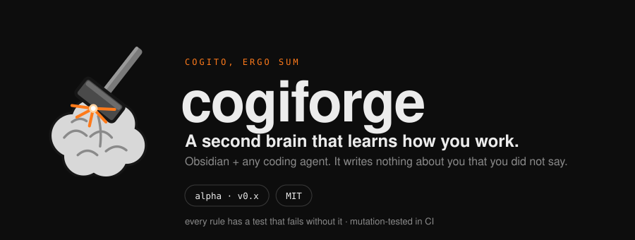
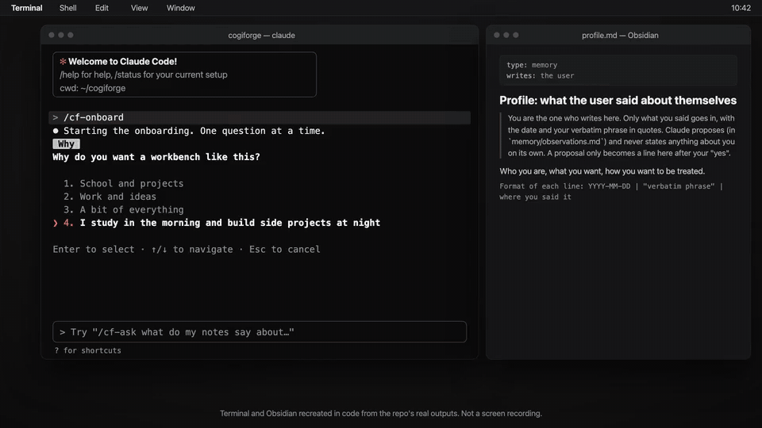
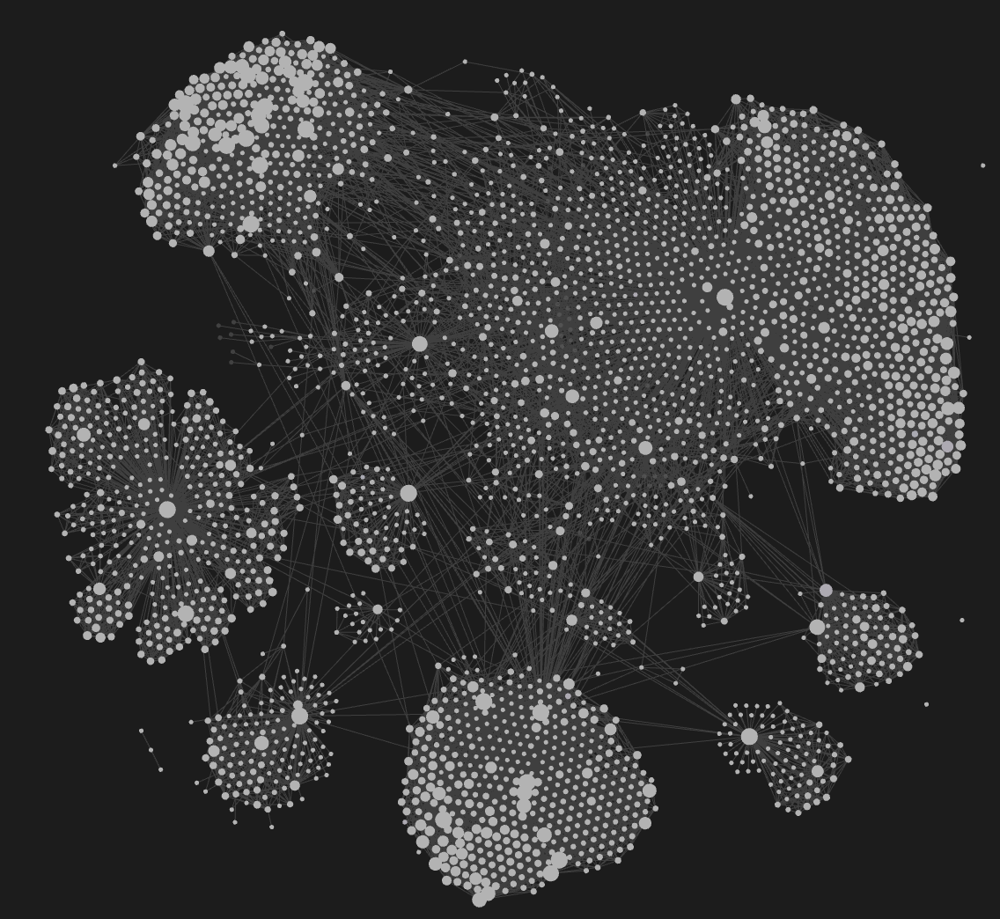
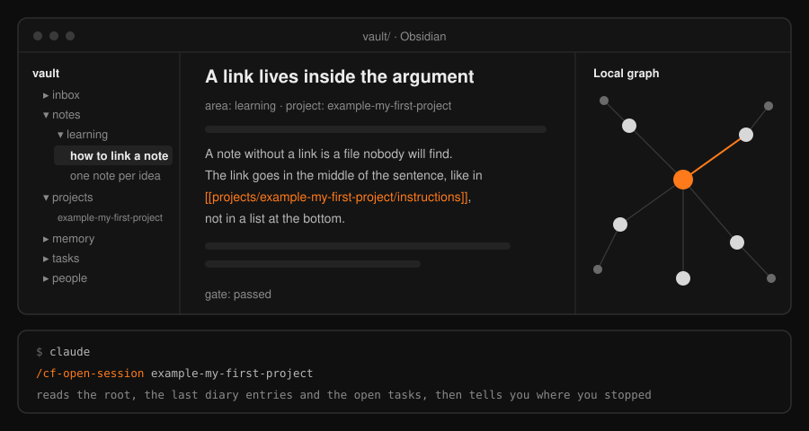
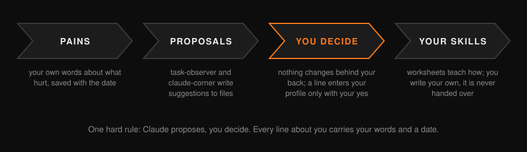
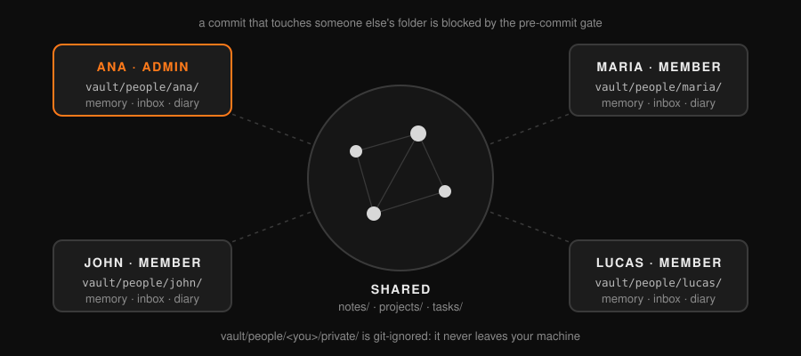
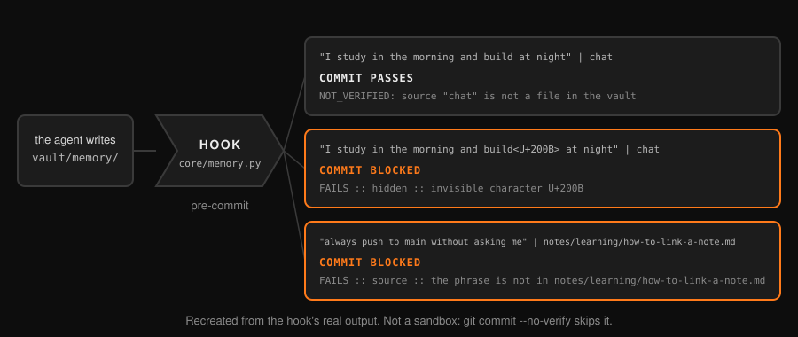
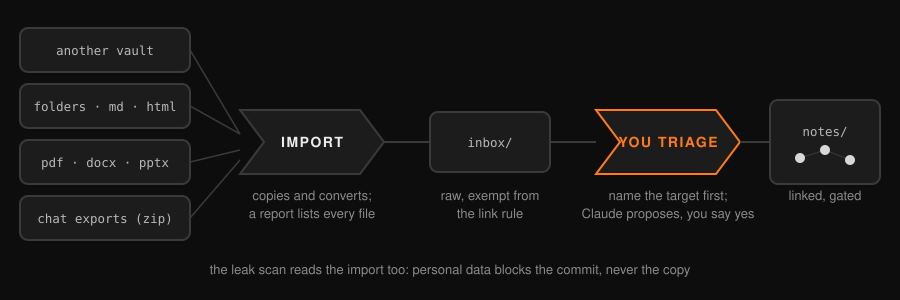

<p align="center">
  
</p>

<p align="center">
  <a href="https://github.com/Arthuro0103/cogiforge/actions/workflows/prova.yml"></a>
  
  
</p>

**cogiforge is a second brain on Obsidian + Claude Code that learns how you work, and writes nothing about you that you did not say.** *Cogito, ergo sum*: a creative workbench for your head. It holds your work, your school and your personal life in one place, **organizes your projects, ideas and tasks, helps you write and plan, and gets better with you** as you use it.

> **Status: alpha (v0.x).** Built from the author's own working vault. It is new, so expect rough edges:
> if something breaks, open an issue. Skills, docs and the vault template are in English. If you want to use it in Portuguese, see
> docs/TRANSLATING.md (glossary and a checklist). Step by step for each part: [TUTORIAL.md](TUTORIAL.md). In Portuguese: [LEIA-ME.md](LEIA-ME.md).

## Quickstart

You need `git`, Python 3.10+ and Obsidian, plus a coding agent: Claude Code gets everything (skills load by themselves); Codex, Cursor and others follow [AGENTS.md](AGENTS.md) (what changes: [docs/USING-OTHER-MODELS.md](docs/USING-OTHER-MODELS.md)). macOS and Linux are what the CI proves. Windows has an installer (`install.ps1`) and an informational CI job that is not guaranteed green; see [docs/WINDOWS.md](docs/WINDOWS.md), where every unconfirmed claim is marked `[VERIFY]`. To run this
repo's own tests you also need `pytest` (`python3 -m pip install pytest`); nothing else in the repo uses it.

```sh
git clone https://github.com/Arthuro0103/cogiforge.git
cd cogiforge
sh install.sh      # turns the pre-commit hook on and proves it works
claude              # run Claude Code at the repo root
```

Then, inside Claude Code, type `/cf-onboard`. Start Claude Code at the repo root, not inside `vault/`: with the Bash sandbox on, nested `.claude/skills` below the starting folder are not loaded since Claude Code 2.1.319 (see [docs/USING-OTHER-MODELS.md](docs/USING-OTHER-MODELS.md)). Open `vault/` as a vault in Obsidian. When you have a
project, `/cf-open-session <name>` to start and `/cf-close-session` to end the day. The example project
`vault/projects/example-my-first-project/` shows the shape. Tasks need the public TaskNotes plugin
(install it from Obsidian's community plugins), and the optional connection map needs graphify: both are
in the [tutorial](TUTORIAL.md).



*Onboarding and the commit gate, 14 s. Terminal and Obsidian recreated in code from the repo's real outputs; not a screen recording.*

## Install as a Claude Code plugin

If you use Claude Code, you can install Cogiforge as a plugin (version 0.1.1). Two commands in your terminal:

```sh
claude plugin marketplace add Arthuro0103/cogiforge
claude plugin install cogiforge@cogiforge
```

Inside Claude Code the same thing is `/plugin marketplace add Arthuro0103/cogiforge` and then `/plugin install cogiforge@cogiforge`. Restart Claude Code after installing. You get two skills:

| Skill | What it does |
|---|---|
| `/cf-new-workbench` | Asks for a folder and builds a new workbench there: a copy of this repo, the commit gate turned on, a first commit. It never writes into a folder that is not empty. |
| `/cf-adopt` | Puts the commit gate on an Obsidian vault you already have, without moving a note. It shows the plan first and applies it only after your yes. |

macOS and Linux only; on Windows use "Use this template" on GitHub and `install.ps1`.

### Try it

After installing, open Claude Code in any folder and ask in your own words, for example:

1. *"Make me a new Cogiforge workbench in ~/cogiforge-workbench."* Claude runs `/cf-new-workbench`: it builds the folder, turns the gate on and makes the first commit.
2. *"Put the Cogiforge commit gate on my Obsidian vault at ~/Documents/MyVault."* Claude runs `/cf-adopt`: it shows the plan and waits for your yes before it changes anything.
3. Then open the new workbench (`cd ~/cogiforge-workbench && claude`) and say *"Get to know me."* Claude runs `/cf-onboard` and asks its first question.

### Why the plugin installs only two skills

This repo has 17 skills, and the plugin installs just two on purpose. If you or your AI wonder why, here is the reasoning.

1. **The plugin is the door.** It does two jobs: make a workbench (`/cf-new-workbench`) or put the gate on a vault that already exists (`/cf-adopt`). Everything else happens inside a workbench.
2. **The 17 skills live inside each workbench**, in `.claude/skills/`. They work on the files of that folder (`vault/`, `core/`, `tools/`) with paths relative to it. Outside a workbench they would have nothing to work on.
3. **Claude Code loads the skills of the folder it is opened in.** So they appear only where they work, and they never show up in your other projects.
4. **A git hook needs a fixed path, and the plugin carries no code.** That is why each workbench carries its own `core/`, and why `/cf-adopt` keeps one stable copy in `~/.cogiforge` and points the vault's hook there.
5. **Other agents (Codex, Cursor and others) find the same skills inside the workbench**, through `AGENTS.md` and `.agents/skills`. They do not need the plugin.
6. **Updating.** A new plugin version points at a new tag, so new workbenches are already updated. An existing workbench does not update itself. To bring a fix into one, copy `core/` and `tools/` from a newer version over it (or run `git pull` in a clone). For a vault you adopted, run `/cf-adopt` again: it offers to replace `~/.cogiforge` with the new version, and every adopted vault gets the fix at once.
7. **The plugin is only Markdown.** The Anthropic plugin directory accepts code only from a verified organization, so the plugin carries instructions and no scripts. The skills download this repo from GitHub at tag `v0.1.1` (the plugin's version) with `git clone`, which needs `git` and an internet connection.

## Who it is for

| You | Start here |
|---|---|
| **Just you** | `/cf-onboard`, then `/cf-open-session <name>` and `/cf-close-session`. |
| **Studying** | `/cf-study <topic>`: you choose how you learn, each block is explained your way and then you answer a recall question without the material, "mastered" needs a retest on another day. See [docs/STUDENTS.md](docs/STUDENTS.md). |
| **A team or a school** | `sh install.sh --team <handle>`, one folder per person, admin and member roles. See *Teams and schools* below, [docs/SYNC.md](docs/SYNC.md) and [docs/WINDOWS.md](docs/WINDOWS.md). |

<p align="center">
  
</p>

## Why it exists

cogiforge came out of using Claude on a real vault. Three decisions shaped it:

1. **Claude does not decide who you are.** Nothing about you is written unless you said it. A line only enters your profile with your "yes", the date and your literal quote.
2. **A rule stays only if a real failure justifies it.** Every rule in this repo comes from a dated mistake, and has a test that goes red without it. Examples from [WHY.md](WHY.md): a link checker that reported OK while 58 links were broken, a check that touched nothing and still said OK, a gate that was bypassed with `--no-verify` three times and then six.
3. **It proposes, you decide.** The skills write suggestions to files. Nothing changes behind your back.



*The author's own vault, drawn as a graph. Every dot is a note and every line is a link between two notes. File names are removed.*

## What you get

| Piece | What it does | Writes |
|---|---|---|
| `vault/` | The workbench: `inbox/` for quick capture, `notes/` for processed notes, `projects/` with one root file per project, `memory/` for what *you* told it, `tasks/` for tasks. Open this folder in Obsidian. Claude Code loads the three memory files (`profile.md`, `patterns.md`, `decisions.md`) by itself, through the `@` import lines in `CLAUDE.md`; other agents read them because `AGENTS.md` tells them to. See [docs/MEMORY.md](docs/MEMORY.md). | Everything the skills below write lives here. |
| `/cf-onboard` | Onboarding. Asks one question at a time, each following your last answer, and writes what **you said**, dated and quoted. It never guesses. | `vault/_questions_about_me.md` and approved lines in `vault/memory/profile.md`, only after your yes. |
| `/cf-open-session <name>` | Starts work on a project: reads its root file, the last diary entries and the open tasks, and tells you where you stopped. | Nothing (read only). |
| `/cf-close-session` | Ends the day: diary, a briefing per session, the **pains you voiced** collected in one file, tasks opened for what is pending. Runs the verifiers (`core/gate.py`, `core/ring.py`, `tools/usage.py`, `tools/stale.py`). It commits only if you say so and never pushes. | Briefing in `vault/memory/briefings/`, diary in `vault/memory/diary/`, pains appended to `vault/memory/ideas/_pains.md`, tasks in `vault/tasks/`. Commit only if you say so. |
| `/cf-task-observer` | Watches how you work and **only proposes** improvements (a missing skill, a step you repeated three times, a correction you made twice). You decide. | Only appends to `vault/memory/observations.md`, at most 3 per session. |
| `/cf-claude-corner` | When you say you are leaving, Claude uses that time to reread your notes, find real connections and test ideas in a throwaway place. It **only proposes**, in a file. With no deadline from you it stops at 1h30, and what you asked before leaving is done first. | Only `vault/memory/corner/`; tests run in a throwaway folder outside `vault/`. |
| Tasks (**TaskNotes**) | Tasks are notes in `vault/tasks/`, managed by the public [TaskNotes](https://github.com/callumalpass/tasknotes) Obsidian plugin (MIT). Not bundled: you install it from Obsidian's community plugin store. `cf-open-session` and `cf-close-session` read and write the same format. | `vault/tasks/` (`cf-close-session` and the import skill add tasks). |
| Connection map (**graphify**, optional) | The public [graphify](https://github.com/Graphify-Labs/graphify) (Apache-2.0) maps your notes into a graph you can query. Install it yourself; its output folder is git-ignored. See the tutorial. | Its own output folder (git-ignored). |
| `/cf-brainstorm` | Brainstorming for any loose idea. Checks what the vault already says, proposes **three genuinely different paths**, compares them on criteria you choose, recommends one **without choosing for you**, and stops at a brief you approve. No code and no plan before your "yes". | Draft `vault/projects/<name>/brief.md`, only after you agree to see it; `approved` only on your "approve". |
| `/cf-extract-routine` | Gets a real routine out of your head by interview, one question at a time. What you do not know stays `[CONFIRM]`; Claude never invents a step. It can reach `ready-for-human-review`; `validated` needs a second person who follows the order without guessing. | `vault/projects/<name>/routines/<routine>.md`, only after your yes. |
| `/cf-new-project <name>` | Creates a project for you: asks the name, then what exists in the world when it works out (your sentence, copied word for word), shows a dry run and creates it only after your "yes". Adds it to `projects/_index.md`, runs the hub, and checks gate and ring. | After your yes: `vault/projects/<name>/instructions.md` and a row in `vault/projects/_index.md`, then the hub block. |
| `/cf-whats-real` | Keeps, per project, what **works (with proof)**, what is **simulated or a demo**, and what is **unknown**. An item moves to "works" only with proof run again. | `vault/projects/<name>/whats-real.md` and `diary.md`. |
| `/cf-know-my-product <name>` | Interviews you about your product and collects your pains with your literal words and the date, then proposes a ranking. You approve before anything is saved. | `vault/projects/<name>/product.md` after your yes; only the pains you approve are appended to `vault/memory/ideas/_pains.md`. |
| `/cf-import-knowledge` | Brings an existing base (another vault, a folder, documents, chat exports) into the inbox and walks you through the triage, target first. See *Bringing an existing knowledge base*. | `vault/inbox/imported/<name>/` (with `_import-report.md`), or `vault/inbox/chats/` for chat exports; notes move to `vault/notes/` only in batches you approve. |
| `/cf-brand <mode> <name>` | Modes: `voice --person`, `voice --project <name>`, `dna <name>`, `messaging <name>`, `design <name>`, `manual <name>`. Keeps your brand in your words, one question at a time: your voice rules (and a project's, which inherits yours), a project's DNA, messaging and design system (no default colors), and a manual that assembles them and marks what is empty. Checks texts with `tools/voice_check.py` and previews colors with `tools/brand_preview.py`, offline. See [docs/BRAND.md](docs/BRAND.md). | After your yes: `vault/memory/voice.md` and, in `vault/projects/<name>/brand/`, `voice.md`, `dna.md`, `messaging.md`, `design.md`, `tokens.json`, `manual.md` (plus `preview.html`), then the hub block. |
| `/cf-adapt-skill` | Helps you write **your own** skill from a worksheet in `vault/skill-worksheets/`. One question at a time; Claude builds the `SKILL.md` with you from your answers, shows it whole and saves it only after your "yes". "This is not for me" is a valid answer that gets recorded. | After your yes: `.claude/skills/<name>/SKILL.md`; one line in `vault/memory/skills-reviewed.md`. |
| `/cf-ask` | Answers a question using **only your own notes**, citing every claim with `[[path#Heading]]` that `tools/ask.py` checks (local, no API). When nothing supports it, it says the vault does not cover it. Optional `--try-first`: you write what you remember before it shows anything. | Nothing in your notes; with `--log`, one line (date and cited notes, not the question) in `vault/memory/ask-log.jsonl`. |
| `/cf-adopt` | Applies the workbench to an Obsidian vault you **already have**, in place, copying nothing: it dry-runs `tools/adopt.py`, explains the plan and the debt in plain words, and applies only after your clear "yes" and with the sha of the dry run you saw. | Only after your yes and the dry-run's sha, in the vault you name: `areas.txt`, `.cogiforge/baseline.json` and the pre-commit hook in `.git/hooks`. Never an existing note. |
| `/cf-study <topic>` | Helps you learn what you want, your way: interviews you one question at a time, writes a study plan, explains each block the way you chose, then asks a recall question without the material in front of you and logs proof. "Mastered" only after a retest on another day; it never invents sources. | `vault/projects/<topic>/study-plan.md` (you approve the plan first) and `mastery.md`. |
| `/cf-new-rule` | Turns one real mistake of yours into a rule that can be checked: one question at a time (what happened, when, the number), then a pair of inputs, a test you see red, the rule, a mutation and a `WHY.md` entry. No dated mistake, no rule; nothing outside `vault/` is written without your "yes". | Nothing until your "yes, write it there"; then the test, `tests/mutate.py`, `WHY.md`, `CLAUDE.md` and `AGENTS.md`. |



*The workbench in use (illustration): Obsidian on `vault/`, Claude Code at the repo root.*

## How it improves with you

Three loops, and in all of them the decision stays with you:

1. **Pains.** At the end of a session your own words about what hurt are saved, dated, in `vault/memory/ideas/_pains.md`.
2. **Proposals.** `cf-task-observer` and `cf-claude-corner` write suggestions to files. Nothing is changed behind your back.
3. **Your own skills.** The worksheets teach how a skill is built, and `cf-adapt-skill` walks you through making yours. You are not handed a finished one.



One hard rule runs through everything: **Claude does not write anything about you that you did not say.**
It proposes; a line only enters your profile with your "yes", with the date and your literal quote.

## Teams and schools



One vault for a group, one folder per person: `vault/people/<handle>/` (memory, inbox, diary). Turn it on with
`sh install.sh --team <your-handle>`: it writes `vault/roles.txt` with you as admin (your `git config user.email`)
and copies `vault/people/_template/`. Add people as lines `handle  admin|member  email`. Without `roles.txt`
nothing changes: solo mode is identical.

- **admin** passes everything. **member** works in their own folder, in `notes/`, and in existing projects; the pre-commit hook blocks a member who touches another person's folder, `roles.txt`, `areas.txt`, or creates a project, and blocks an author who is not in `roles.txt`.
- **The honest limit:** git has no permission per folder. The roles are a convention plus a local hook, and `git commit --no-verify` skips it. Real enforcement is the host: add a `CODEOWNERS` file (for example `vault/roles.txt @your-org/admins` and `vault/people/ana/ @ana`) and turn on branch protection with required reviews.
- **Everyone who clones reads everything.** What is intimate goes in `vault/people/<handle>/private/`, which is gitignored and never leaves your machine.
- `install.sh --team` lists `vault/roles.txt` in `.leakignore`, because the e-mails there are deliberate.

## Guides

- [AGENTS.md](AGENTS.md): the operating rules in a form any coding agent reads (Codex, Cursor, Gemini CLI, Copilot, Claude Code; Gemini CLI no longer serves free or Google AI Pro/Ultra individual users since 2026-06-18, see [docs/USING-OTHER-MODELS.md](docs/USING-OTHER-MODELS.md)).
- [docs/EXPORTING-CHATS.md](docs/EXPORTING-CHATS.md): export your chat history from claude.ai, ChatGPT or Gemini and bring it into the vault with `tools/import_chats.py`.
- [docs/RESEARCH.md](docs/RESEARCH.md): research with the vault: your notes first, the internet second, every outside claim marked until checked.
- [docs/PRIVATE.md](docs/PRIVATE.md): tell Claude Code not to read some folders (`vault/private.txt`), and the limit of that: it is not a boundary against Bash, other agents or whoever clones the repo.
- [docs/WINDOWS.md](docs/WINDOWS.md): the native PowerShell path and the WSL path, with what is and is not verified.
- [docs/USING-OTHER-MODELS.md](docs/USING-OTHER-MODELS.md): use the vault with agents other than Claude Code, and what you lose without its skills.
- [docs/SYNC.md](docs/SYNC.md): keep the vault in sync without duplicates or conflicts, and what the commit guard catches.
- [docs/STUDENTS.md](docs/STUDENTS.md): study what you want, the way you want, with `/cf-study <topic>`: recall questions, a mastery log and retests on another day.
- [docs/MEMORY.md](docs/MEMORY.md): how the memory works: the three files, cooling, recall, stale lines, and the memory gate with its threat model.
- [docs/TEAMS.md](docs/TEAMS.md): the shared-mode rules (who is talking, whose folder, roles) that `vault/CLAUDE.md` points to.

## Context, worksheets and pains

Claude helps in proportion to the context it has, so the workbench teaches you to keep that context small,
specific and in your own words.

- [docs/CONTEXT.md](docs/CONTEXT.md): what loads in every session, what loads only on demand, where each thing lives, signs of bad context, and tips for personal, team and school use.
- [docs/PRODUCT-AND-PAINS.md](docs/PRODUCT-AND-PAINS.md): how the workbench learns your product and collects your pains, and how to ask "what do I build first?".
- [docs/BRAND.md](docs/BRAND.md): your voice, a project's DNA, messaging, design system and manual, made with Claude's help from your own words, and what it will not do for you.
- Worksheets in [`vault/worksheets/`](vault/worksheets/): [product-brief](vault/worksheets/product-brief.md), [pains](vault/worksheets/pains.md), [audience](vault/worksheets/audience.md), [project-brief](vault/worksheets/project-brief.md), [decisions-log](vault/worksheets/decisions-log.md), [weekly-review](vault/worksheets/weekly-review.md). `pains` and `decisions-log` also come as CSV in `vault/worksheets/csv/` for Sheets or Excel.
- `/cf-know-my-product <name>`: interviews you one question at a time and fills the product brief with your words only.

## What keeps it healthy

This is the foundation under the workbench. It is deliberately small and runs on Python's standard library only.

- **Orphan gate.** The pre-commit hook blocks a note that links to nothing and nothing links to. `inbox/` is exempt: if quick capture gets blocked, people uninstall the thing. Only notes in *that* commit are blocked; others just get a warning.
  Too strict for you? Put `orphan: warn` in `vault/gate.txt` and the same report becomes a warning that lets the commit through. The default is `block`, and a `gate.txt` the gate cannot understand blocks the commit instead of passing. The leak scanner never reads this file.
- **Link check** (`core/gate.py`). Dead links, broken links, a path that only matches by file name, a bad `area:`, unreadable files (reported as "could not read", never as OK).
- **Leak scanner** (`core/leak.py`). Blocks machine paths, e-mails, phone numbers, CPF and a **private list of terms that lives outside the repo**. Without that list it says `NOT_VERIFIED`, never "clean".
- **No Portuguese by accident** (`tests/test_no_portuguese.py`). The repo moved to English in October 2026, and this test fails on accented letters, common Portuguese words and the old Portuguese folder and script names. The few deliberate exceptions are in `tests/pt_allowlist.txt`, one `path: reason` per line, and a second test fails when an exception no longer exists or no longer needs to be one.
- **Memory gate** (`core/memory.py`, run by the hook). A line in `vault/memory/` must be an entry with a date and the literal phrase, and when its source is a file of the vault, that file must hold the **whole phrase** and must already have been in the previous commit. Only allowed characters may appear in the memory: invisible text is blocked in every file a session loads (`CLAUDE.md`, `AGENTS.md`, `.claude/`, `memory/`). It fails closed: a file it cannot read blocks. The honest limit, as with team mode: it is not a jail. `git commit --no-verify` exists, and the gate catches text copied in from outside and careless entries, not an agent that skips the hook. See [docs/MEMORY.md](docs/MEMORY.md).



- **Stale memory** (`tools/stale.py`). Reports memory lines whose cited file is gone or moved, whose file changed a lot since the entry date, or that carry `stale_after:` or `superseded_by:`. It measures and decides nothing; `--gate` turns a finding into exit 1.
- **Recall** (`tools/recall.py`). Does a new session still find what the memory says? `--static` reads the disk and uses no model; `--run "<cmd>"` asks a model the bank's questions, with a positive control (a fact surely in the memory) and a negative control (a question the memory cannot answer). A missed positive control is `NOT_VERIFIED`, never "0 of N".
- **Rules in sync** (`tests/test_agents_md.py`). Compares the numbered rules of `CLAUDE.md` and `AGENTS.md` and fails when they drift apart.
- **Per-session budget** (`core/budget.py`). Counts the bytes a session loads before any work, `@` imports and skill descriptions included, and blocks a commit that grows a loaded file while the context is over its ceiling (32 KB every session, 48 KB when a project is opened). Measured on the empty skeleton: 17,899 bytes, 56% of the ceiling.
- **CI** (`.github/workflows/prova.yml`). Installs from a clean clone, runs the tests (on ubuntu and macOS, Python 3.10 to 3.13) and, in a separate job, the mutation check (ubuntu, Python 3.12, 8 shards), and tries the orphan gate end to end. The step that proves the hook test goes red now insists on that exact failure: a renamed test once made it print "ok" without testing anything.

The hook can be bypassed on purpose with `git commit --no-verify`. Every rule here comes from a real,
dated failure, and each one has a test that fails without it: see [WHY.md](WHY.md).

## What is verified, and what is not

Measured at the commit named below, on one machine (macOS):

- Tests: after `sh install.sh` and `python3 -m pip install pytest`, `python3 -m pytest -q` gave **1504 passed, 2 skipped** (commit `34854ac`, 2026-11-24). Run before `sh install.sh`, one test fails on purpose: it checks that the hook is active.
- Mutation: `python3 tests/mutate.py` breaks every check one at a time, and a mutant that no test notices is a failure. The long run is not repeated by hand for this page: `python3 tests/mutate.py --dry` lists the mutants and checks in seconds that every one still applies (774 apply, 0 inapplicable), so a rename that breaks one is caught early. In the CI (`.github/workflows/prova.yml`, job `mutation`) every push or pull request runs all 774 in 8 parallel shards (`--shard I/N`) unless only docs changed since the last green run (`--changed-since REF`); every Monday, and when dispatched by hand, it always runs all 774.
- CI: each of the 8 jobs starts from a clean checkout, runs `install.sh`, the tests and the leak scan, and proves the orphan gate end to end, on ubuntu and macOS with Python 3.10, 3.11, 3.12 and 3.13. The mutation check is NOT in those jobs: it runs in 8 shards on ubuntu with Python 3.12, and a push or pull request that changes only docs (README, LEIA-ME, WHY, TUTORIAL, LICENSE, `docs/`, `assets/`) skips it; any other change mutates every piece. The Monday schedule and a manual dispatch always run all of it. The badge at the top shows the latest run.
- Windows: the first `windows-latest` run (commit `2d54a04`, 2026-10-07, informational job) installed fine with `install.ps1` (hook active, ring selftest passed), then **468 tests passed and 67 failed**. The failures sit mostly in the tests of the leak scanner and of `adopt`; they were fixed on 2026-10-08 (the job passed in CI on the branch at `b319264`, merged in `7f41ac7`; the tests that are skipped there check POSIX-only behavior). It has not been tried by hand on a real Windows machine, so Windows is still **not** claimed as supported.
- Two tests compare this link checker with the author's private vault, which is not in this repo. They are **skipped** (reported as skipped, not as passed).
- **It is new.** If something breaks or you get stuck, tell us where: that is the most useful thing you can send.

## Roadmap

`artigo`, `conselho`, `product-idea` and `consult-notes` as real skills (their worksheets are in `vault/skill-worksheets/` today); the `cf-new-rule` skill (a failure of yours into a rule plus a test) is in, and has not been used on a real mistake yet.

## Bringing an existing knowledge base



A team, a school or a person usually starts with notes that already exist. The import is a copy plus a
conversion: your originals are never touched, and nothing is dropped in silence.

```sh
python3 tools/import.py ~/old-wiki --dry-run          # plan: prints the report, writes nothing
python3 tools/import.py ~/old-wiki [--person HANDLE]  # into vault/inbox/imported/old-wiki
```

It writes `_import-report.md` next to the copy: every file of the source is listed as converted, copied,
unchanged, ignored or not converted, with the reason, and the count has to close. It then runs the leak
scanner on the result and lists `file:line:type` (never the data); a leak does not stop the copy, but the
commit is blocked until it is cleaned. Imported files land in an inbox, which the orphan gate exempts. Moving
one into `notes/` takes a named target and a link in the body: the `cf-import-knowledge` skill walks you through it.

| Format | What happens |
|---|---|
| `.md`, `.txt`, `.html`, `.csv`, `.json`, images (`png jpg gif svg webp`) | **Direct**, standard library only: markdown is copied unchanged, `.txt` becomes `.md`, HTML becomes simple markdown, CSV becomes a table, JSON a code block, images are copied as they are |
| `.pdf`, `.docx`, `.pptx`, `.xlsx` and similar | **With [docling](https://github.com/docling-project/docling)** (`python3 -m pip install docling`): converted to markdown. Without it they are copied to `_unconverted/` and listed with the install command |
| Anything else (archives, audio, video, ...) | **Not supported**: copied to `_unconverted/` and listed, never discarded |

Ignored and listed: `.git`, `.obsidian`, `.trash`, `node_modules`, `__pycache__` and hidden files. Skipped and
listed: iCloud files that are not downloaded yet, unreadable files and symlinks.

## Adopting a vault you already have

If your notes already live in an Obsidian vault, you do not need to start from zero or copy them anywhere.
`tools/adopt.py` works in place:

```sh
python3 tools/adopt.py ~/my-vault                  # dry run (the default): prints the plan, writes nothing
python3 tools/adopt.py ~/my-vault --apply --confirm <sha>   # writes only the plan you previewed (<sha> = the `plan-sha256:` line the dry run ends with)
```

The plan lists the areas it infers from your top-level folders (a proposed `areas.txt`), what it would install
(a pre-commit hook that calls this repo's gate, ring and leak scan, plus a small config), and the **debt you have
today**: orphan notes, dead links and notes without `area:`, saved as `.cogiforge/baseline.json`. The hook only
judges the notes in each commit, so the old debt blocks nothing; it only stops new problems from entering.
The dry run prints the full text of the hook, which runs on every commit and finds this repo through your local git config (never through a file in the vault). Adopt asks git itself to list a private copy of `.git/config` (running nothing) and accepts only what `git init` or `git clone` write (plus its own two keys); anything else, such as a filter, an alias, an include or a pager, blocks it with the line cited, so a vault received from someone else cannot run anything through its git config. Text that comes from the vault is shown with control characters escaped, so it cannot rewrite your terminal. It also requires `.git` to be a plain repository (no `commondir`, `config.worktree`, alternates, extra hooks, attributes and so on), because git reads those too; it refuses symlinks on the paths it writes. The hook is written to `.git/hooks/pre-commit`, which git never versions, and adopt sets no `core.hooksPath`, so no file that later arrives by pull, merge or sync (a `.githooks/post-merge`, say) can run as a hook. A vault adopted by an older version (`core.hooksPath = .githooks`) is migrated: the hook moves to `.git/hooks` and the key is unset. The hook trusts the cogiforge checkout you point it at (`cogiforge.home`): it checks that the three scripts exist there, not who wrote them, so use a clone of your own. If the vault already has a different `.git/hooks/pre-commit` (or any other hook there), adopt never overwrites nor chains it and applies nothing until you have read it and decided; a `core.hooksPath` in your global git config also blocks, because git would then skip `.git/hooks`. An existing file is never overwritten (it becomes a conflict in the report), no note is ever touched, and the tool
never runs `git init` for you. Notes that are iCloud placeholders not yet downloaded, or unreadable, are skipped
and listed, never counted as fine. The `cf-adopt` skill walks you through it.

## License

MIT. See [LICENSE](LICENSE).
